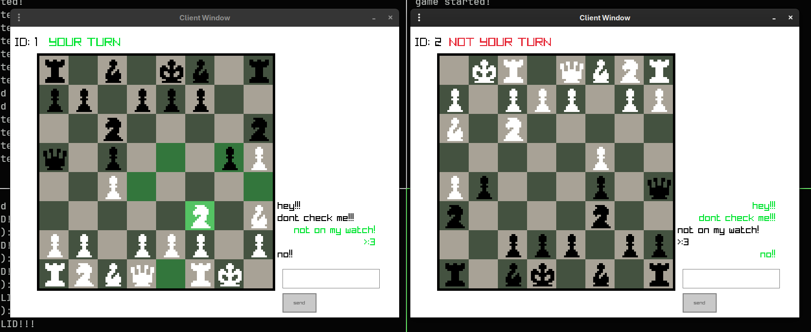

# CounterChess

### Game Description
The game is like the typical game of chess with black and white pieces that are composed of pawns, horses, bishops, rooks, kings and queens such that the goal is to checkmate the opponent such that the board that flips every turn during the game.

###  Game Mechanics
- The game follows the basic rules of traditional chess, where two players take turns moving their pieces around the board.

- Players take turns making moves, with the first move made by the black player, followed by the white player, and continuing alternately.

- Here's the twist! **The Board Switch Mechanic**. The main twist is that after every move, the chessboard switches its orientation to the perspective of the next player, basically switching sides.  And also has a random chance for certain pieces to switch its roles and such! Like your pawns can suddenly be rooks, or your queen can suddenly become a pawn! This creates a unique challenge, requiring players to adapt to the changing board view and moveset.

- Each chess piece follows its traditional movement rules, and players must protect their king while attempting to checkmate their opponent.  The game ends when one player successfully checksmate the opponent's king.

## Programming Side
### Networking side
- This project follows a client-server architecture in networking,
`src/client.c` and `src/server.c`.  Both utilize the sending of
**PACKETS**, present in `include/packets.h` with the necessary data.  Given
that `send(...)` and `recv(...)` may not return the expected size of data,
helpers `sendAll(...)` and `recvAll(...)` are present in
`src/helpers.c`

### Game side
- Utilizes a chess-engine written from scratch `src/chess/chess*`. Although
for now, some implementation may not be the best choices due to it's
brute-force creation :sob:, current version is not final and is still subject
to change and optimization and correctness

## TODO
- [ ] Have handling of actual board state be outside of the actual chess move checker
    - [ ] create another `movePiece...` function that handles the moving of pieces
- [ ] Have rendering of chess pieces/board be independent of hardcoded values and such
    - [ ] have a more sophisticated system of rendering, use dedicated coordinates for the board and pieces to allow for animations
>>>>>>> C_convert
